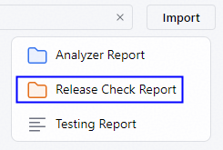
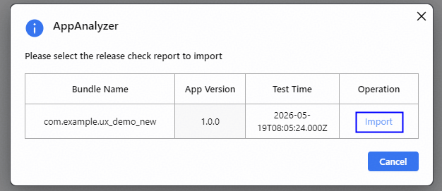
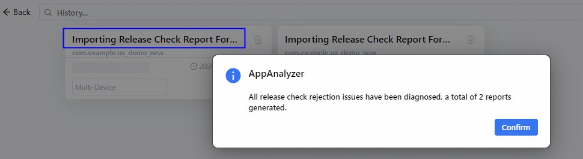

# 导入上架检测报告进行诊断

更新时间：2026-08-29 09:41:34

来源：https://developer.huawei.com/consumer/cn/doc/harmonyos-guides/ide-release-check-report

应用在AppGallery申请上架会对UX、稳定性、功耗、性能和兼容性等专项进行审核。从26.0.0版本开始，AppAnalyzer支持导入上架审核不通过的报告并进行诊断分析，帮助定位可能的故障原因并生成体检报告。
 

## 使用约束

- AppAnalyzer支持导入UX、功耗、性能专项报告进行诊断分析。
- AppAnalyzer仅支持对手机的报告进行诊断分析。

 
 

## 操作步骤
1. 点击菜单栏**Tools > AppAnalyzer**，打开AppAnalyzer页面，点击底部**History**打开历史报告页面，点击右上角的**Import > Release Check Report**。

2. 确认需要导入的上架检测报告，点击**Import**。

3. 根据界面提示，确保即将导入的上架报告满足相关要求。

  选择是否授权AppAnalyzer获取应用上架驳回问题关联的hiperf数据，用于诊断问题的可能故障原因。在**AppAnalyzer**页面，点击底部**Settings**也支持进行堆栈授权**。**

  

4. 诊断完成后，会提示生成的体检报告的数量，请在当前的历史报告页面中查看对应的报告。

5. 查看体检报告。
**源文件、调优文件（包含trace文件和调用栈文件）或snapshot文件、时间戳等**：点击源文件可跳转到问题源码，点击调优文件或snapshot文件支持直接拉起性能分析工具Profiler并导入性能检测的问题数据进行调优分析，点击时间戳可以打开Profiler并定位到问题发生的时间范围。
6. **分析文档**：点击链接可跳转至官网文档，参考文档对检测出来的问题进行分析。
7. **优化建议**：针对可能的故障原因，给出对应的最佳实践，点击链接可跳转至官网文档。
