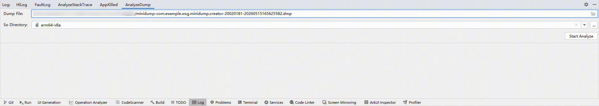
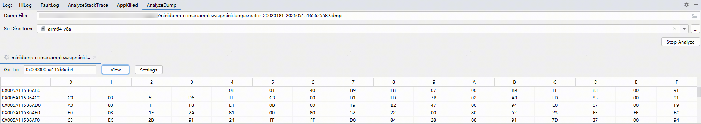
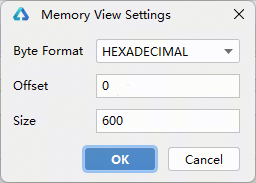

# 解析应用minidump/coredump文件

更新时间：2026-08-29 09:41:34

来源：https://developer.huawei.com/consumer/cn/doc/harmonyos-guides/ide-analyze-dump

从26.0.0版本开始，DevEco Studio支持对应用minidump/coredump文件进行解析，展示堆栈信息，帮助开发者快速定位问题。
 

## 获取dump文件

- minidump文件：获取方式请参考[OH_HiAppEvent_SetEventConfig接口说明](https://developer.huawei.com/consumer/cn/doc/harmonyos-guides/hiappevent-watcher-crash-events#oh_hiappevent_seteventconfig接口说明)。
- coredump文件1. 应用需要在module.json5中配置[ohos.permission.ALLOW_COREDUMP权限](https://developer.huawei.com/consumer/cn/doc/harmonyos-guides/permissions-for-all#ohospermissionallow_coredump)，配置方式请参考[声明权限](https://developer.huawei.com/consumer/cn/doc/harmonyos-guides/declare-permissions)。

2. 在2in1设备的任务管理器中右键应用进程，选择**创建转储文件**。

3. 创建成功后，会提示coredump文件的保存位置。

 
 

## 解析dump文件
1. 打开DevEco Studio的**Log**窗口，点击**AnalyzeDump**页签打开界面，选择要解析的dump文件和带调试信息的so目录（默认是模块下的build/{product}/intermediates/libs/{target}/{abi}，其中product和target默认是default，{abi}是设备CPU架构类型，如arm64-v8a），点击**Start Analyze**开始解析。
> [!NOTE]
> 应用产生的dump，需要借助同一次构建生成的so文件中的符号信息才能解析。若使用源码变更后重新构建生成的so目录，可能会因符号不一致导致解析结果不准确或解析失败。

  

2. 等待解析成功后，默认会展示异常线程和对应的堆栈，展开堆栈可查看变量信息，支持切换查看不同线程的堆栈，点击堆栈中的超链接可以跳转到对应的源码。

3. 支持查看指定地址的内存，填写内存地址，点击**View**即可查看。也可以直接右键点击变量查看内存。

  点击**Settings**，可设置进制、偏移量和展示的内存字节数量。

  

